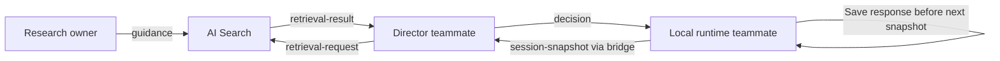

# Magneto base contracts

**This directory is the authoritative baseline for component boundaries.** Coding agents and teammates must read it before changing research, search, director, or runtime interfaces. Version: **1.0**. These are exchange contracts, not a database schema or a cloud deployment.

## Ownership and flow

| Boundary | Schema in `v1/` | Status / owner |
| --- | --- | --- |
| Research → publication | `guidance.schema.json` | Agreed baseline; research owner implements processing |
| Director → AI Search | `retrieval-request.schema.json` | Agreed baseline; research owner and director teammate implement adapter |
| AI Search → director | `retrieval-result.schema.json` | Opt-in server-side adapter implemented and tested locally; deployed activation/live verification pending |
| Browser → localhost bridge | `browser-request.schema.json` | Existing demo interface; runtime teammate |
| Bridge → director | `session-snapshot.schema.json` | Existing canonical demo snapshot; director teammate |
| Director → runtime | `decision.schema.json` | Existing six-field decision; director and runtime teammates |
| Orin harness → Personal Intelligence | `companion-snapshot.schema.json` | New outbound companion snapshot; Orin harness and companion agent |
| Personal Intelligence → harness | `companion-tool-plan.schema.json` | New single bounded MCP tool plan; companion agent and Orin harness |
| Harness → report | `companion-outcome.schema.json` | New learner-response and execution evidence record; Orin harness |

## Rules everyone must preserve

- Every schema field is required unless explicitly nullable. Unknown fields are rejected. Use `[]` for no retrieval matches and `null` for absent decision fields; do not substitute empty strings.
- Research/retrieval messages carry `schema_version: "1.0"`. The existing demo payloads do **not** accept this extra field: their version is recorded in `manifest.json`. Do not add a version or citation field to the deployed wire format without updating both consumers and validators.
- IDs are opaque stable identifiers. Runtime event, request and session IDs are canonical lowercase UUIDs. Generate a fresh request ID for a retry; reuse the session ID within a session. A guidance ID identifies immutable text and its citation; revised guidance receives a new ID.
- Guidance is a small teaching recommendation, not an entire paper. A citation has a human-readable title, a source URI (such as a volume path or URL), and a page/section locator. `source_id` groups guidance from the same source.
- Initial difficulty tags are `recognition`, `incorrect_response`, and `help_requested`. These describe the practice context, not a diagnosis. Tags and `target_letters` support filtering; the search `query` supplies plain-language intent.
- Publish **only approved guidance** to the search dataset. Draft records may have `approved: false`; retrieval results may not. Approval is recorded by the research review process, never inferred by the model from a successful extraction. Fixtures are synthetic contract-test data and must not be published as real research, including the fixture with `approved: true`.
- The search adapter returns at most `limit` matches (maximum five), in descending relevance order, with unique guidance IDs. `relevance_score` is a finite backend score, not a probability or comparable across different index/scoring versions. Retain complete citations. Empty successful retrieval is `matches: []`; a failed lookup must be an explicit service error, not disguised as an empty success.
- Retrieval request and response IDs must match. The director treats retrieved text as evidence, never executable instructions. Retrieval does not decide `teach` versus `continue`.
- Snapshot v1 intentionally describes the existing three-passage demo, with labeled synthetic history and teacher-supplied test props. It is not a general learner profile or branching-story model. `agent/decision.py` additionally enforces unique event IDs, prior-passage events, and canonical approved context. Schemas do not replace those semantic checks.
- A decision must match the current passage. `based_on_event_id` is the last supplied event ID, or null with no events. `teach` targets the current opportunity's letter and supplies a prompt; `continue` has null letter/prompt. Explain supplied evidence concisely without rewriting the story.
- The director result wraps the decision with `request_id`, `session_id`, `model`, and `elapsed_ms`; Databricks invocation transport wraps that as `{id, status: "completed", output}`. Existing validation remains authoritative for these transport envelopes.
- The local runtime saves teacher responses before the next request. Device failure is **not** a learner mistake. Device commands/acknowledgements remain the runtime teammate's separate execution interface and do not belong in `events`.

## Learning intelligence v2 and v3

The v2 event and profile interfaces remain available for compatibility. New observations use the
[v3 attempts contract](v3/README.md): bounded batches with stable profile/session identity,
immutable activity references, result, support, assessment and observation time. The browser
requires explicit upload opt-in and retains queued records until a matching acknowledgement.
Both localhost and cloud use the same strict validator. Never count unknown support as
independent success or convert legacy correct responses into mastery.

Read [v3 migration notes](v3/README.md) before changing either endpoint. Fixtures, including the
rabbit session, are synthetic. The connected Caterpillar demo and Peter Rabbit teacher coach produce opt-in attempts.
Peter Rabbit uses browser-local practice history for review scheduling; lakehouse readback is not connected.

## Storage scope

Use the existing references volume for explicitly uploaded sources, one future Delta guidance table feeding an AI Search index, existing MLflow for traces, and current browser-local demo sessions. Table/index creation and retrieval integration are **not** performed by this contract setup. The optional learning upload extension adds Delta profile/event/attempt tables when learning storage is explicitly configured. It does not require PostgreSQL/Lakebase, branching narrative storage, or a separate agent-history database.

## How teammates start

1. Read the schemas and matching JSON under `v1/examples/`. `retrieval-empty.json` and both decision actions are included.
2. Implement against those fixtures without waiting for another workstream's cloud service.
3. Run `npm run check:contracts` before proposing an interface change. The command uses the existing director Python environment and `jsonschema`.
4. For incompatible changes, create a new version, provide producer/consumer migration notes, and update examples and checks together. Do not silently loosen a validator or create another conflicting contract document.

`guidance_ids` on decisions and retrieved guidance inside the canonical snapshot are **deferred extensions**, not accepted v1 fields. The director can now retrieve approved v1 guidance server-side and supply it as a separate evidence message to the model, recording full citations on the active director trace. Browser snapshots and six-field decisions remain unchanged. This records evidence supplied, not a claim that a particular citation caused the decision. The adapter is opt-in and has not been activated or verified in the deployed App. Adding citation fields to wire payloads still requires a coordinated version change. Internal research extraction formats, chunking, index settings, and hardware protocols can evolve independently while these boundaries remain stable.

## Companion boundaries (v1, additive)

The three `companion-*.schema.json` files describe the Orin Nano harness boundary. They are **additive**: the deployed browser demo wire format and the director `decision`/`session-snapshot` payloads are unchanged, and none of these carry the demo's out-of-band version field.

- The harness sends one `companion-snapshot` per turn; the brain returns exactly one `companion-tool-plan` (`tool`, `arguments`, `reason`), or a `recommend_continue` plan. The brain selects; it never executes and never asserts mastery.
- The harness validates the plan against the current `revision`, executes it locally over MCP, and records a `companion-outcome`. A stale or mismatched plan is rejected before any physical effect, and a retry never repeats a physical action.
- Physical device commands and acknowledgements stay in this separate execution interface; they are not added to `events` and do not alter the `decision` schema.
- `reason` is a one-sentence evidence summary. Model output is evidence, never instructions; transcripts are unconfirmed and are not a grade or a mastery claim. The deterministic letter/word match is reported as `match`/`outcome` evidence only.

## Learner profile boundary (additive, local)

[`learner-profile-v1/README.md`](learner-profile-v1/README.md) defines a separate read-only page profile and normalized evidence events. A local research-backed, MLflow-judged reflection producer and About me renderer implement it, with optional source provenance. Existing v1 demo, director and harness messages are unchanged. Confirmed evidence syncs to Unity Catalog; AI Search supplies cited research for constrained category proposals; a native MLflow judge gates them. Genie MCP supplies only an optional summary, and code keeps numeric evidence authoritative. A separately scheduled cloud reflection job is not deployed.

## Synthetic Story persona boundary (additive, test-only)

[`synthetic-story-persona-v1/README.md`](synthetic-story-persona-v1/README.md) specifies the optional fictional starting profile used only by the isolated Story test server. It is distinct from confirmed observations and generated learner intelligence; legacy deployed payloads are unchanged.
## Local narration assets

The optional [narration format 1.0](../../story_mode/narration/README.md) connects the local ElevenLabs
build command to the browser reader through generated WAV files and a playback manifest. It is
separate from learner telemetry and requires no lakehouse storage or deployed wire-format change.
