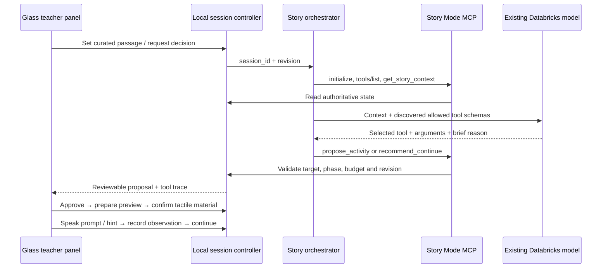

# Story Mode MCP scaffold

A local, teacher-supervised orchestrator for Peter Rabbit. It discovers real MCP tools, reads the
current controller snapshot, asks the existing Databricks model to choose a tool, and invokes that
tool through MCP stdio. It has no rules-based substitute for a failed model call.



## Run

From the repository root:

```sh
python3 -m venv .venv-story
.venv-story/bin/python -m pip install -r story_mode/requirements.lock
python3 scripts/serve.py --port 8091
```

The lock records the dependency versions used for local verification. SDK documentation:
https://py.sdk.modelcontextprotocol.io/v1/ (the 1.x maintenance line is intentionally pinned).
Open `/learn/#stories`, open the included Peter Rabbit, and select **Teacher coach**.
On the introduction to the four rabbits, gate passage, or vegetables passage, select **Ask orchestrator**.
The browser sends only a curated passage ID and anonymous teacher observations, not the EPUB or recordings.
The local adapter uses the existing `magneto` Databricks profile/config in
`databricks/platform/services.toml`. No credentials are returned to the browser. A failed model request
shows an error; it never silently creates a mock teaching decision.

## Contracts

- `controller.py`: authoritative anonymous in-memory sessions, atomic transitions, revision checks,
  approved targets, six-activity session budget, deterministic lowercase UEB/uncontracted cell preview.
- `mcp_server.py`: official SDK stdio transport, tools/list + tools/call; forwards to the same viewer controller.
- `orchestrator.py`: one bounded model-selected call per teacher request, using discovered MCP schemas.
  Only `propose_activity` and `recommend_continue` are available to this decision step.
- `scripts/story_bridge.py`: same-origin teacher endpoints and private MCP bridge protected by a per-process
  random key. Orchestrator subprocesses inherit that key; it is never exposed to the browser.
- `web/learn/story-coach.js`: glass panel, explicit speech buttons, observation buttons, visible tool trace.
  It does not announce teacher notes or model reasons to the learner.

The controller enforces:

`reading → proposed → awaiting_tactile → ready → waiting_response → complete → reading`

An optional unconfirmed transcript adds `awaiting_confirmation` before the teacher observation.
Only teacher endpoints can approve, confirm tactile material, record observations, or resume.
The model cannot score transcripts. A hint prevents an independent-recognition observation.
Changing the passage invalidates the prior revision and discards the activity. A stale model response
cannot start a new activity. The panel can be dismissed without advancing the lesson.

### MCP tool catalog

| Tool | Effect |
|---|---|
| `get_story_context` | Read passage, relevant targets, prior observations, policy, phase and revision |
| `propose_activity` | Propose introduce / identify / match for a letter or word; teacher review required |
| `recommend_continue` | Suggest continuing without interrupting the story |
| `prepare_braille` | Produce deterministic visual cells after approval; physical ready remains false |
| `speak_prompt` | Queue approved learner speech only after teacher confirms tactile material |
| `give_hint` | Queue approved support and mark assistance used |
| `submit_response` | Record an unconfirmed transcript; no grading |

All mutating tools require `session_id` and the current `revision`. MCP outputs supply the next revision.
The stdio server needs `MAGNETO_STORY_URL` and `MAGNETO_STORY_KEY`, supplied automatically by the local
orchestrator. It is intentionally not registered globally with any desktop agent.

## Scope and limitations

This is an executable scaffold, not a validated curriculum. Targets are curated for three Peter Rabbit
moments; the browser matches known passage text, not vision/OCR or autonomous curriculum extraction.
Activities and observations last for the current book-opening session and server process. Reading
bookmarks and existing imported ebooks keep their existing browser-local persistence.

The Story Mode orchestrator is local and uses the existing model endpoint directly through the shared
platform adapter. The deployed Caterpillar LangGraph agent and its approved narrow contract are unchanged.
The orchestrator displays a concise evidence summary and tool trace, never private chain-of-thought.

No microphone capture, speech recognition, hardware actuation, automatic mastery scoring, or durable
learner records are implemented. Braille is a visual preview; the teacher must supply tactile material.
Browser text-to-speech runs only after an explicit teacher action. It is not recorded narration.

## Verification

```sh
npm run check
npm run check:story
```

The MCP tests start an ephemeral localhost viewer and use an injected deterministic model fixture to
exercise the actual SDK handshake, discovery and tool execution. They test stale navigation and forbidden
teacher actions without calling a model. A separate manual browser run verifies live-model integration.

Verified locally: 8 controller tests and 4 real-stdio MCP tests pass. A live browser run at the
Peter Rabbit vegetables spread returned an orchestrator-selected `propose_activity` for `l`;
teacher approval produced the deterministic dots 1, 2, 3 preview while physical readiness remained false.
No child response or physical tactile-material confirmation was fabricated in that browser run.

## Test with Alex Morgan

Run `python3 scripts/serve_story_test.py` and open `http://127.0.0.1:8100/learn/?profile=synthetic-test#stories`.
Open Peter Rabbit, seek to the four-rabbits introduction (page 3), open **Teacher coach**, and select **Ask orchestrator**.
The coach shows **Fictional test · Alex Morgan** and the expandable starting profile. The live model receives this seed through MCP; no learner outcomes are prefilled.
Approve the proposal, offer fictional test material and speak the prompt. Type a reply in **Reply as Alex**, then use **Ask for a follow-up** to test how the model adapts. Every follow-up remains a proposal for teacher review. Try one pattern at a time, such as confusing a letter with a word or saying “I’m confused.”

The seed is saved in `story_mode/personas/alex-morgan.json`. It is not a diagnosis or confirmed evidence. Per-session test snapshots and transcripts are saved under `reports/storybook-session-test/sessions/`; test coach sessions are not restored after reload. Identification outcomes are marked synthetic and saved separately; the existing explicit cloud-test command can upload those outcomes to the fictional table. Persona storage itself is local, not a new Databricks table. Ordinary `python3 scripts/serve.py` sessions are unchanged.
