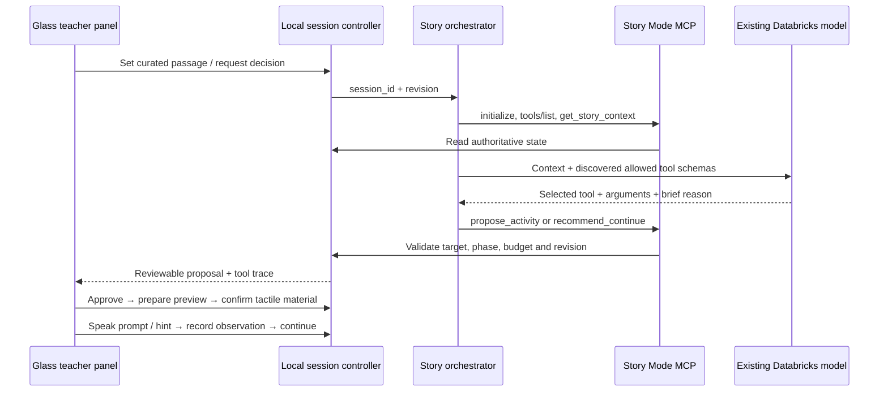

# Story Mode MCP scaffold

A local, teacher-supervised orchestrator for Peter Rabbit. It discovers real MCP tools, reads the
current controller snapshot and builds a compact decision context. The reader prepares a validated
teaching proposal in the background; explicit use applies it through the same local tool dispatcher
as MCP. The original direct decision path remains available through MCP stdio. At the activity limit, a deterministic rule recommends continuing.
Other choices use the existing Databricks model. A failed model call leaves the session unchanged
so the teacher can retry or continue; it never silently substitutes a teaching decision.



## Run

From the repository root:

```sh
python3 -m venv .venv-story
.venv-story/bin/python -m pip install -r story_mode/requirements.lock
python3 scripts/serve.py --port 8091
```

The lock records the dependency versions used for local verification. SDK documentation:
https://py.sdk.modelcontextprotocol.io/v1/ (the 1.x maintenance line is intentionally pinned).
Open `/learn/#stories`, open the included Peter Rabbit, and select **Teacher coach**.
Opening the introduction to the four rabbits, gate passage, or vegetables passage starts background
preparation. Select **Use prepared decision** when ready, or **Wait for decision** to wait for the current
preparation. If preparation fails, **Ask orchestrator** retries it; continuing the story remains available.
The browser sends only a curated passage ID and anonymous teacher observations, not the EPUB or recordings.
The local adapter uses the existing `magneto` Databricks profile/config in
`databricks/platform/services.toml`. No credentials are returned to the browser. A failed model request
shows an error; it never silently creates a mock teaching decision.

## Contracts

- `controller.py`: authoritative anonymous in-memory sessions, atomic transitions, revision checks,
  approved targets, six-activity session budget, deterministic lowercase UEB/uncontracted cell preview.
- `mcp_server.py`: official SDK stdio transport, tools/list + tools/call; forwards to the same viewer controller.
- `selection.py`: current opportunity plus at most four relevant teacher observations; deterministic
  activity-limit rule, eligible tool list, and strict argument validation.
- `orchestrator.py`: one bounded selected call per teacher request, using discovered MCP schemas.
  Only `propose_activity` and `recommend_continue` are available to this decision step.
- `scripts/story_bridge.py`: same-origin teacher endpoints and private MCP bridge protected by a per-process
  random key. Orchestrator subprocesses inherit that key; it is never exposed to the browser.
- `web/learn/story-coach.js`: glass panel, explicit speech buttons, observation buttons, visible tool trace.
  It does not announce teacher notes or model reasons to the learner.

The controller enforces:

`reading → proposed → awaiting_tactile → ready → waiting_response → complete → reading`

An optional unconfirmed transcript adds `awaiting_confirmation` before the teacher observation.
Only teacher endpoints can approve, confirm tactile material, record observations, or resume.
The model cannot score transcripts. A hint prevents an independent-recognition observation.
Changing the passage invalidates the prior revision and discards the activity. A stale model response
cannot start a new activity. The panel can be dismissed without advancing the lesson.

### MCP tool catalog

| Tool | Effect |
|---|---|
| `get_story_context` | Read passage, relevant targets, prior observations, policy, phase and revision |
| `propose_activity` | Propose introduce / identify / match for a letter or word; teacher review required |
| `recommend_continue` | Suggest continuing without interrupting the story |
| `prepare_braille` | Produce deterministic visual cells after approval; physical ready remains false |
| `speak_prompt` | Queue approved learner speech only after teacher confirms tactile material |
| `give_hint` | Queue approved support and mark assistance used |
| `submit_response` | Record an unconfirmed transcript; no grading |

All mutating tools require `session_id` and the current `revision`. MCP outputs supply the next revision.
The stdio server needs `MAGNETO_STORY_URL` and `MAGNETO_STORY_KEY`, supplied automatically by the local
orchestrator. It is intentionally not registered globally with any desktop agent.

## Initial responsive selection boundary

The controller remains the single owner of state. The selector sees only session/revision, phase,
approved opportunity, policy, activity count, and the last four teacher observations for the current
targets. It does not receive transcripts, device previews, execution traces or unrelated observations.
An omitted-observation count makes the partial history explicit. This is recent session evidence,
not a student mastery summary. Full observations remain in the controller.

The selector can propose an activity or recommend continuing. At the six-activity limit only
`recommend_continue` is eligible and the model is skipped. Selection cannot run during an active
activity. The plan is checked before calling MCP; the controller atomically checks the revision again
when applying it. Late results, invalid arguments and model failures cannot advance the session.
Teacher approval, speech buttons and tactile confirmation keep their existing execution behavior.
A proposal acknowledgement is not physical action or speech completion.

Background learning is a separate workstream. Its prepared student summary and methods still need
an adapter into this Rabbit selector. Do not add live lakehouse queries or research searches to this
path. Durable restart recovery and device completion acknowledgements are also outside this initial
change. Existing deployed v1 and learning v2/v3 payloads are unchanged.

### Prepare during reading; apply at the interaction point

`story-preparation.js` starts one request per current browser session/revision when a curated passage
opens. It does not pause reading, speak, or apply an activity. The ready plan stays on the server;
the browser holds only a preparation ID. The model prepares the existing activity, prompt and hint.
Subsequent repeat/hint/teacher-observation controls already execute locally without another model
call; this change does not add autonomous grading or a generated response-branch tree.

The server discovers the real MCP schemas and validates the plan without calling a mutating MCP
tool. On explicit use, it checks identity, revision, phase, budget and arguments again under the
controller lock, then invokes the same controller dispatcher used by the MCP bridge. This avoids
starting a new MCP process on the prepared fast path. A plan is single-use; navigation or any lesson
state change makes it stale. An old completion cannot overwrite a newer preparation. Failures leave
lesson state unchanged and permit an explicit retry. No background retry loop runs.

These additive localhost routes require the same Host/Origin checks as existing teacher routes:

- `POST /api/story/prepare`: `{ "session_id": "<current UUID>", "revision": 1 }` returns
  `{ "preparation_id": "<opaque UUID>", "revision": 1, "status": "ready" }` after preparation.
  Repeating a ready request returns the same handle; an in-flight duplicate returns an error.
- `POST /api/story/apply-prepared`: `{ "session_id": "<current UUID>", "revision": 1,
  "preparation_id": "<opaque UUID>" }` returns the normal `state` wrapper and preparation/apply
  diagnostics. The client cannot provide or replace the cached plan. Stale or consumed handles fail.

No cloud contract or MCP tool signature changes. Old clients can keep using `/api/story/orchestrate`.
Restart the local server and reload the reader to use the new routes. The cache is ephemeral and holds
at most one entry per controller session (the existing controller caps sessions at 100). Speculative
work already running may finish after navigation, but cannot change the lesson or become usable.

The optional [local narration build](narration/README.md) generates cached passage WAV files and a
versioned manifest through ElevenLabs. The reader plays these local files with explicit controls;
passage-open remains the decision-preparation trigger. Audio pauses on navigation or teacher
interaction. No live synthesis or lakehouse lookup occurs during playback. The example covers two
Rabbit excerpts, not the whole book; API voice generation still needs configured credentials.

One local synthetic live test measured **3,912 ms** for preparation and **0.47 ms** for the later HTTP
apply request (**0.05 ms** inside the dispatcher). Preparation left the controller state exactly unchanged.
These are single-run localhost timings, excluding browser rendering, speech, hardware and human review.
The preparation delay is hidden only if it finishes before the interaction is requested.

### Latency diagnostics

The local response's existing `orchestrator` diagnostics now include `timings_ms` and
`selection_payload_bytes` (UTF-8 bytes, not tokens; excludes the system prompt). Timings separate
MCP startup/discovery/read, selection including validation, MCP application, total orchestration
including cleanup, and bridge total including the orchestrator subprocess. The browser continues
to consume `state`; these optional diagnostics do not change MCP tool arguments or the teaching state.

A local synthetic measurement on 2026-10-11 found five activity-limit decisions took **495–690 ms**
at the bridge. One live-model decision took **4,088 ms**, including **3,346 ms** for selection and
**2.46 ms** for MCP application. Its selection payload was **1,660 bytes**. These are small-sample
observations on this machine, not production percentiles or a latency guarantee. Browser rendering,
speech and hardware completion are excluded. No learner records were uploaded in these measurements.

The direct decision path and background preparation start the orchestrator and MCP processes; even the
rule path pays that startup cost. Keeping MCP alive would be a later measured optimization. The
existing 18-second model read timeout and 35-second subprocess limit remain failure ceilings, not
responsiveness targets. The model call is the largest measured delay; do not put it on every low-level
speech or device transition.

## Scope and limitations

This is an executable scaffold, not a validated curriculum. Targets are curated for three Peter Rabbit
moments; the browser matches known passage text, not vision/OCR or autonomous curriculum extraction.
Activities and observations last for the current book-opening session and server process. Reading
bookmarks and existing imported ebooks keep their existing browser-local persistence.

The Story Mode orchestrator is local and uses the existing model endpoint directly through the shared
platform adapter. The deployed Caterpillar LangGraph agent and its approved narrow contract are unchanged.
The orchestrator displays a concise evidence summary and tool trace, never private chain-of-thought.

No microphone capture, speech recognition, hardware actuation, automatic mastery scoring, or durable
learner records are implemented. Braille is a visual preview; the teacher must supply tactile material.
Browser text-to-speech for teaching prompts runs only after an explicit teacher action. Optional
recorded book narration is a separate local audio player, built ahead of the session.

## Verification

```sh
npm run check
npm run check:story
```

The MCP tests start an ephemeral localhost viewer and use an injected deterministic model fixture to
exercise the actual SDK handshake, discovery and tool execution. They test stale navigation and forbidden
teacher actions without calling a model. A separate manual browser run verifies live-model integration.

The current checks cover 5 browser-preparation tests, 15 controller/selection/preparation tests, and
9 MCP/HTTP integration tests, including context minimization, rule bypass, stale navigation,
invalid arguments, model failure, no effects during preparation, cache reuse and single-use apply.
Earlier live verification: A live browser run at the
Peter Rabbit vegetables spread returned an orchestrator-selected `propose_activity` for `l`;
teacher approval produced the deterministic dots 1, 2, 3 preview while physical readiness remained false.
No child response or physical tactile-material confirmation was fabricated in that browser run.

## Test with Alex Morgan

Run `python3 scripts/serve_story_test.py` and open `http://127.0.0.1:8100/learn/?profile=synthetic-test#stories`.
Open Peter Rabbit, seek to the four-rabbits introduction (page 3), open **Teacher coach**, and select **Ask orchestrator**.
The coach shows **Fictional test · Alex Morgan** and the expandable starting profile. The live model receives this seed through MCP; no learner outcomes are prefilled.
Approve the proposal, offer fictional test material and speak the prompt. Type a reply in **Reply as Alex**, then use **Ask for a follow-up** to test how the model adapts. Every follow-up remains a proposal for teacher review. Try one pattern at a time, such as confusing a letter with a word or saying “I’m confused.”

The seed is saved in `story_mode/personas/alex-morgan.json`. It is not a diagnosis or confirmed evidence. Per-session test snapshots and transcripts are saved under `reports/storybook-session-test/sessions/`; test coach sessions are not restored after reload. Identification outcomes are marked synthetic and saved separately; the existing explicit cloud-test command can upload those outcomes to the fictional table. Persona storage itself is local, not a new Databricks table. Ordinary `python3 scripts/serve.py` sessions are unchanged.
## Interaction audio and two-page look-ahead

See [the tool audit and local endpoint contract](INTERACTION_AUDIT.md) for each audio trigger,
state gate, speculative preparation, invalidation and remaining integration limits.
